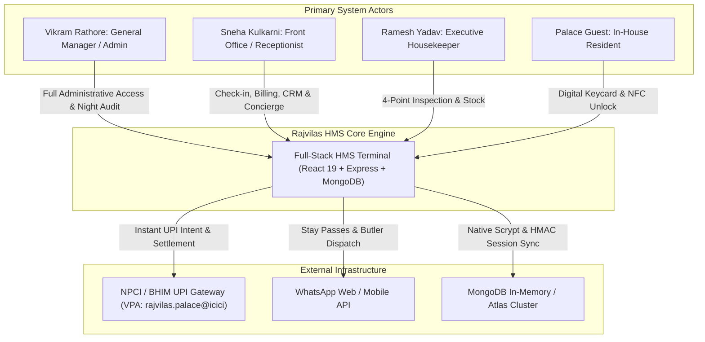
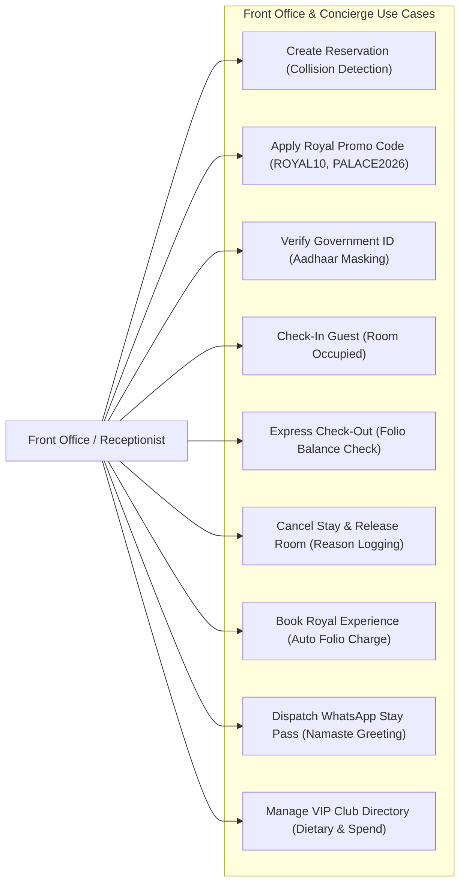
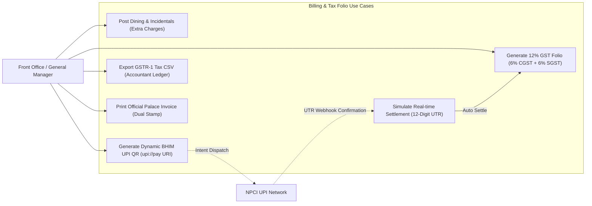
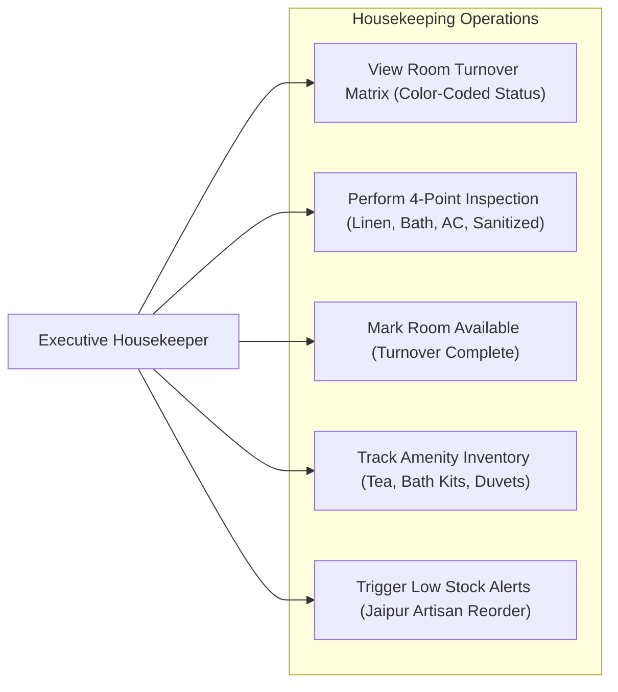
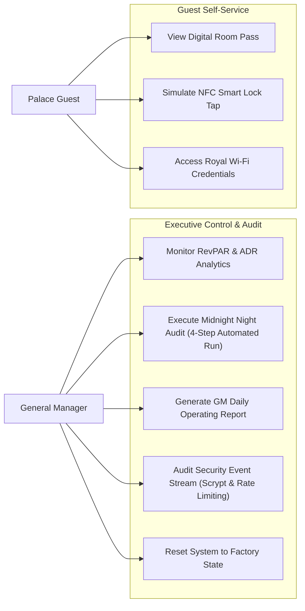
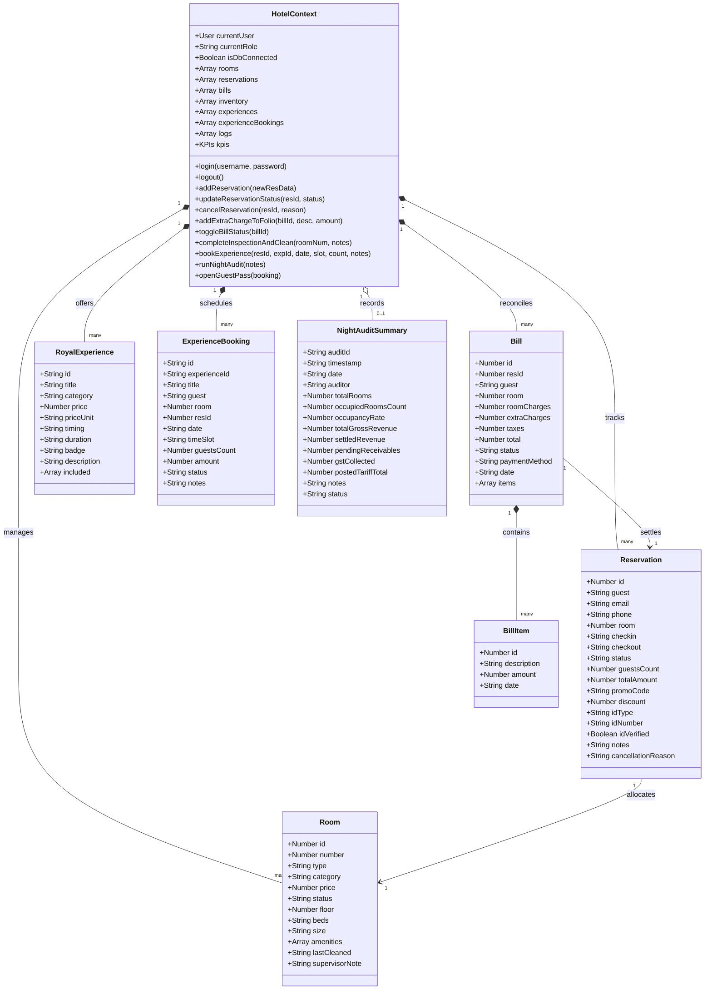
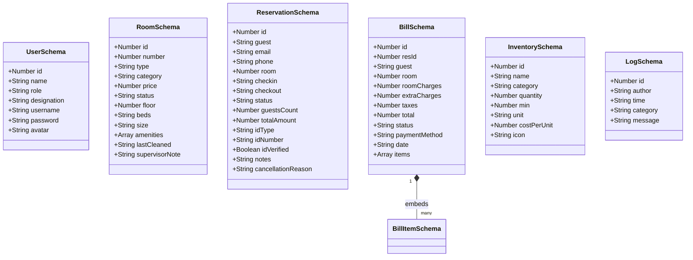

# Rajvilas Heritage Palace & Resort — Architecture & UML Design Specification

This document presents the **Reverse-Engineered Software Design & Architecture** derived directly from the codebase of **Rajvilas Heritage Palace & Resort** (Udaipur, Rajasthan • GSTIN: `08AAACL7891F1Z2`).

---

## 🏛️ 1. System Context & Actor Hierarchy

The system enforces strict **Role-Based Access Control (RBAC)** across three staff roles, one guest actor, and two external gateways:

---

## 🎯 2. UML Use Case Diagrams

### A. Front Office, Reservations & VIP Concierge
The Front Office module handles the full guest lifecycle, from arrival to stay enhancement:

### B. Billing, 12% GST Tax Invoicing & Instant UPI Settlement
Covers financial transactions, extra charges, and statutory tax compliance:

### C. Housekeeping, Turnover & Inventory Stock
The sanitization and inventory replenishment pipeline:

### D. Executive Oversight, Night Audit & Guest Pass
Strategic controls reserved for General Manager Vikram Rathore:

---

## 📐 3. UML Class Diagrams

### A. React Client Domain Model (`HotelContext`)

---

### B. Backend REST API & MongoDB Mongoose Models

---

## 🏗️ 4. Layered System Architecture

```mermaid
flowchart TD
    subgraph PresentationLayer["Layer 1: Presentation & UI (React 19 + Tailwind CSS)"]
        NavBar["Navbar & Global Triggers"]
        SideNav["Role-Filtered Sidebar"]
        DashView["Executive Dashboard & RevPAR"]
        TimeView["Timeline & Date Conflict Engine"]
        ResView["Reservations & Check-In Desk"]
        BillView["GST Folio & BHIM UPI QR Modal"]
        ExpView["Palace Royal Experiences Desk"]
        AuditView["Automated Night Audit Modal"]
        PassView["Guest Digital Keycard Portal"]
    end

    subgraph StateLayer["Layer 2: State & Context Management"]
        Context["HotelContext.jsx (Optimistic State + Polling Fallback)"]
        ApiClient["api.js (Axios Client with Bearer Token Injection)"]
    end

    subgraph SecurityLayer["Layer 3: Native Zero-Install Security Suite"]
        SecHeaders["Security Headers (X-Frame, CSP, HSTS)"]
        RateLimiter["Login Rate Limiter (5 attempts / 15 min)"]
        AuthGuard["HMAC-SHA256 Token Auth Guard"]
        RoleGuard["RBAC Guard (Admin, Reception, Housekeeping)"]
    end

    subgraph ControllerLayer["Layer 4: Express REST API Controllers"]
        AuthRoutes["/api/auth (Scrypt constant-time login)"]
        RoomRoutes["/api/rooms (Status & 4-Point Inspection)"]
        ResRoutes["/api/reservations (Collision Prevention)"]
        BillRoutes["/api/bills (12% GST & Incidentals)"]
        InvRoutes["/api/inventory (Housekeeping Stock)"]
        AuditRoutes["/api/logs (Audit Trail)"]
    end

    subgraph PersistenceLayer["Layer 5: Data Persistence"]
        MongoDB["MongoDB (Mongoose ODM / Auto-Local Memory Cluster)"]
        LocalStorage["Client-Side LocalStorage Fallback"]
    end

    PresentationLayer --> StateLayer
    StateLayer --> SecurityLayer
    SecurityLayer --> ControllerLayer
    ControllerLayer --> PersistenceLayer
```

